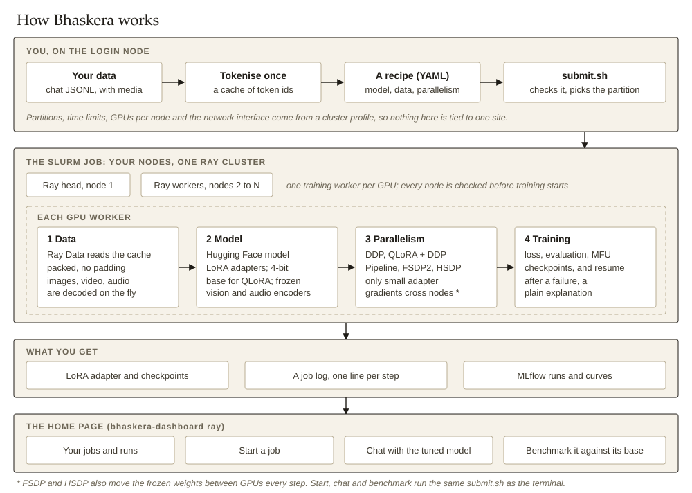

# Bhaskera

Bhaskera fine-tunes large language models on Slurm GPU clusters. You describe a run in one YAML file (the model, the data,
how to spread it over the GPUs) and submit it. Bhaskera starts Ray on the nodes your job gets, trains LoRA adapters,
checkpoints, and logs the results. It also handles models that read images, video and audio.

It started on PARAM Rudra (2 × A100 80 GB per node) and has been run there on 8 to 128 nodes with models from 14B to 235B
parameters. Nothing in the code is specific to that machine: partitions, GPUs per node and the network interface come from a
small [cluster profile](#other-clusters), so it should run on yours.

Version 1.0.0. Python 3.11, PyTorch 2.6, transformers 4.57. The full guide is at
<https://kishoryd.github.io/ParamRudra-20PF-UserManual/bhaskera/>; this page is the short version.



## Try it

On PARAM Rudra the module has everything:

```bash
module load bhaskera/1.0.0
cp -r $BHASKERA_KIT ~/bhaskera-runs && cd ~/bhaskera-runs        # or any folder you choose; the home page makes ~/bhaskera-runs for you if you skip this

./submit.sh recipes/qwen3-14b-qlora.yaml 8 1     # recipe, nodes, hours
```

`submit.sh` checks the recipe on the login node first (model files, libraries, data, whether it fits in GPU memory), picks the
partition, and submits. A first job runs only 10 steps, so you see whether everything works in a few minutes.

To install your own copy, see [Install](#install) below.

## Your own model and data

Compute nodes have no internet, so download the model on a login node (`huggingface-cli download ...`). Data is a JSONL file with
one conversation per line (`chatml`, `alpaca` and `sharegpt` are built in). Tokenise once, then train:

```bash
./submit.sh tokenize recipes/tokenize-chatml.yaml    # prints two cache paths: put them in your recipe
./submit.sh recipes/qwen3-14b-qlora.yaml 8 12
```

Before tokenising, `python -m bhaskera.launcher.data_tools inspect|dedupe|filter|split` finds duplicates, empty answers and
rows that are too long.

## Recipes and starter configs

`slurm/recipes/` has eleven tested recipes for nine models (Qwen3, Llama 3.3, Mistral Large, BharatGen Param), each with
its measured speed in the header. For a model that is not there, copy a starter from `configs/`: DDP, FSDP2, HSDP and pipeline for text models, and image, video
and audio for multimodal ones, each with its tokenizer config. `configs/config.yaml` lists every option. A key
that does nothing, like a typo, is reported with the closest real name.

## Parallelism

Choose it per run in the YAML:

- **QLoRA + DDP**: dense models up to about 123B; the fastest option at every node count.
- **DDP**: models that fit on one GPU, around 14B.
- **Pipeline**: MoE models and very large dense models.
- **FSDP and HSDP**: when nothing else fits. The weights cross the network every step, so it is slower.

With LoRA only the small adapter gradients travel between nodes, so DDP, QLoRA and Pipeline scale almost linearly. Qwen3-14B
with QLoRA trains one epoch of 1.24B tokens in 49 minutes on 128 nodes at 34% MFU. More numbers are in the docs.

## Images, video and audio

Qwen3-VL (image, video) and Qwen2.5-Omni (audio) train with DDP, FSDP2 or HSDP, and the same recipes and Slurm setup. Media
files stay on disk and are decoded while training. Pipeline, QLoRA and packing are not available for these models yet.
See `docs/multimodal/README.md`.

## Where your files go

Everything you create stays in the folder you set up, the one that holds `submit.sh` (your *run folder*): `recipes/`, `checkpoints/`, `cache/` (prepared data), `logs/`,
`tasks/` (your own tests), benchmark results, `mlflow-runs/` (every run, its adapter, and the model registry), `.bhaskera/` (small settings) and `.cache/huggingface/`
(benchmark data). Nothing is written to the shared install. If you name no run folder, `~/bhaskera-runs` is made from the shared kit. If you already keep `~/mlflow-runs`, `~/.bhaskera` or `~/.cache/huggingface`, Bhaskera keeps
using them until a copy or a link of the same name exists in the run folder (`ln -s ~/mlflow-runs mlflow-runs` brings them in with nothing moved). `MLFLOW_TRACKING_URI` overrides the MLflow place.
Shared models and prepared data (`BHASKERA_MODELS`, `BHASKERA_DATA`) are read-only copies kept by the administrators.

## The home page

```bash
bhaskera-dashboard ray
```

prints one SSH command for your laptop. Open <http://localhost:8265>. It has five pages (Home, Train, Serve, Evaluate, Monitor), and everything below is also available from the terminal:

- **Jobs and runs:** live loss, MFU, GPU load and the **GPU energy** a run used, the logs, and links to MLflow and the Ray Dashboard. A job can be cancelled, and a chat server closed, with two clicks.
- **New run:** make a recipe from a few choices (text or multimodal; QLoRA, DDP, FSDP2, HSDP, Pipeline, or your own YAML with every setting reachable), prepare raw data, then train, resume or cancel. *Check first* runs every check and submits nothing.
- **Chat** with a trained model (tuned, base, or side by side; pictures and audio can be attached), **benchmark** one or several models with the standard tests or your own, **compare** them, and **register** a model under a name with a hand-off note (`name@alias` works wherever a run id does).
- **Downloads:** a model or dataset from Hugging Face into a folder you choose, with sign-in for private and gated repositories.
- **Data:** give a data folder a name, a number and a fingerprint, so every run records exactly what it trained on.

To test a model on your own questions, `python -m bhaskera.launcher.evaluate init-task` turns a question/answer JSONL file into a test, and `evaluate review` shows what tuning fixed, what it broke and what is still wrong.
If a job stops half way, `./submit.sh resume --run <run id>` (or **Resume**) continues from the last checkpoint; `--step N` goes back to an earlier one. A checkpoint is saved every 500 steps by default (`checkpoint.save_every_steps`).
Before each job every node is checked, and a failed job ends with a plain explanation of what went wrong and on which node. `BHASKERA_HUB_LAUNCH=0` turns starting jobs from the page off.

## Sweeps

`python -m bhaskera.launcher.sweep plan|submit|report sweep.yaml` runs one recipe with many values (grid or random), queues the
trials within your Slurm limits, and lists them best first.

## Other clusters

Everything that belongs to one cluster is in a **cluster profile** (partitions and their time limits, GPUs and their memory, CPUs and host memory per node, network interface):

```bash
cp slurm/clusters/example.yaml .bhaskera/cluster.yaml          # in your run folder; then edit it
python -m bhaskera.launcher.cluster_profile show
```

Without one, `submit.sh` uses `$BHASKERA_PARTITION` and the hours you give. To install Bhaskera for everyone on a new cluster, follow
[Setting Up on Another Cluster](https://kishoryd.github.io/ParamRudra-20PF-UserManual/bhaskera/new-cluster/) in the guide.
It has been run end to end only on PARAM Rudra.

## Install

```bash
git clone https://github.com/kishoryd/Bhaskera.git && cd Bhaskera
BHASKERA_CUDA=12.4 bash setup.sh           # name the CUDA version: login nodes have no GPU
source .venv/bin/activate
uv pip install -r slurm/requirements-paramrudra.lock    # the package versions the benchmarks used
export BHASKERA_DIR=$PWD
```

For all users of a cluster, `slurm/install-bhaskera.sh` builds a shared install and `slurm/modulefiles/` has the Lmod modulefile; flash-attention and the other details are in the guide.

## Security

The home page is private to your user, MLflow and the Ray Dashboard listen on the local machine only, and the Ray Dashboard is
read-only through the home page. [SECURITY.md](SECURITY.md) says what is protected and how to report a problem.

## Known limits

- MoE models are slow outside Pipeline. The BharatGen MoE models run under FSDP only.
- DDP needs the whole model on each GPU. Qwen3-235B does not fit with QLoRA.

## What you control, and what Bhaskera handles

**Yours to edit:** the recipe or config for a run (`slurm/recipes/`, `configs/`), the cluster profile (`slurm/clusters/`), the
environment variables named in `src/bhaskera/launcher/README.md`, and your data. Each config key is described in the README of the
folder it belongs to: `data/`, `models/`, `distributed/`, `trainer/` and `utils/` under `src/bhaskera/`.

**Handled for you:** starting Ray on the nodes Slurm gives you, finding the layers LoRA and the parallel strategies need, sharding,
checkpoint writing and resuming, node checks, choosing the partition, and the home page. These are in `src/bhaskera/`, and you do not
need to touch them.

`scripts/` has a few tools: multimodal sample data, adapter export, and the MXFP4 converter. The history is in
[CHANGELOG.md](CHANGELOG.md).
